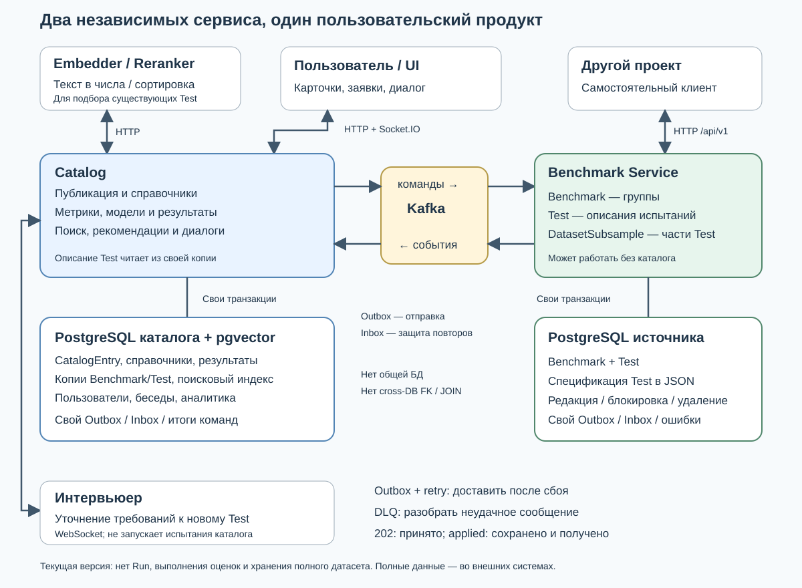
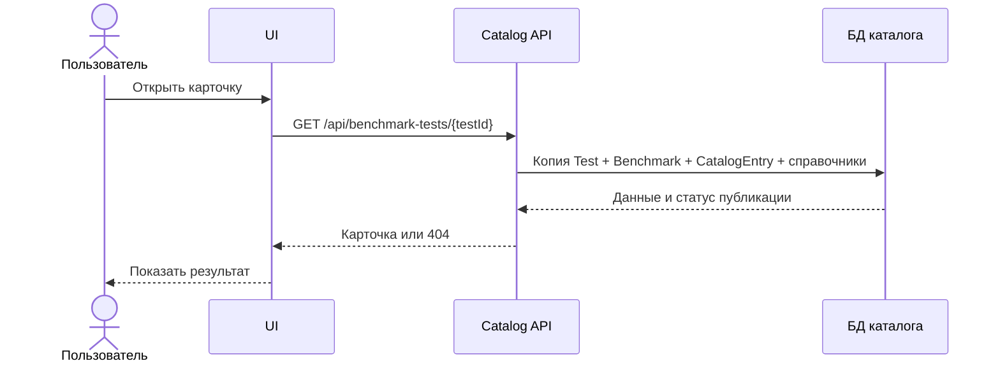
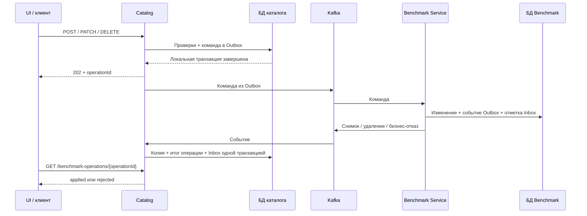

# Архитектура: кто отвечает за что

Актуально для реализации после разделения, 16.09.2026. Для первого знакомства прочитайте [обзор продукта](project-overview.md).

## 1. Общая схема



Схема показывает направления обмена, а не порядок запуска. PostgreSQL у сервисов отдельные. Стрелки Kafka не означают HTTP-вызовы.

Текстовая версия:

```text
Браузер / UI
  │ HTTP: карточки, фильтры, заявки, модерация, результаты
  │ Socket.IO: диалог и доставка рекомендаций
  ▼
CATALOG ───────── HTTP ───────► Embedder / Reranker
  │                            преобразование текста / сортировка
  ├──────── WebSocket ───────► Интервьюер
  │                            уточнение требований к новому Test
  │
  ├── БД каталога: публикация, справочники, результаты, копии Test, поиск
  │
  └── Outbox ─► Kafka: commands ─► BENCHMARK SERVICE
                                      │
                                      ├── своя БД: Benchmark + Test
                                      │             + DatasetSubsample внутри Test
                                      │
            CATALOG ◄─ Kafka: events ◄─ Outbox
               │
               └── обновляет копию Test и статус операции

Другой проект ── HTTP /api/v1 ──► BENCHMARK SERVICE
                                 каталог для этого не нужен
```

В этой версии каталог не обращается к HTTP API Benchmark Service при каждом открытии карточки или сохранении. Его рабочая интеграция — Kafka. HTTP API источника существует для самостоятельного использования сервиса.

## 2. Зачем здесь два сервиса

Benchmark Service отвечает на вопрос: **«Как описано это испытание?»**

Каталог отвечает на вопросы: **«Можно ли показывать его пользователю? Как его найти? Кто его предложил? Какие результаты уже загружены?»**

Это позволяет использовать описания испытаний в другом проекте без пользователей, интерфейса и правил публикации нашего каталога. Отдельный сервис не превращает каталог в пустой прокси: каталог продолжает владеть своей бизнес-логикой.

| Информация | Владелец | Что хранит другая сторона |
| --- | --- | --- |
| Benchmark, описание Test, DatasetSubsample | Benchmark Service | Каталог хранит полученную копию для чтения |
| Редакция описания и запрет менять Test | Benchmark Service | Каталог хранит редакцию/признак блокировки в копии |
| Автор, модератор, статус публикации | Каталог | В Benchmark Service этого нет |
| Названия справочников, их иерархия | Каталог | В описании Test — только внешние UUID |
| Определения Metric, Model и численные результаты | Каталог | В Test — UUID назначенных Metric |
| Поисковый индекс и рекомендации | Каталог | В Benchmark Service этого нет |
| Диалоги, гипотезы, пользователи, API-ключи, аналитика | Каталог | В Benchmark Service этого нет |
| Полный набор исходных данных Test | Внешняя система | Сервисы хранят ссылки и примеры, а не весь набор |

**UUID** — идентификатор вида `4442ee17-dd60-43f0-9421-ccceba3b1d13`. Он позволяет однозначно сослаться на объект, даже если его название изменилось.

## 3. Внутреннее устройство каталога

| Модуль / путь | Ответственность |
| --- | --- |
| `src/catalog/benchmark/`, `benchmark-test/`, `catalog-view/` | HTTP API групп и карточек; чтение представления каталога |
| `src/catalog/projection/` | Приём событий источника, хранение копий, преобразование их в ответы UI |
| `src/benchmark-service/integration/` | Подготовка команд, запись в Outbox, проверка статуса операции |
| `src/catalog/catalog-entry/` | Заявки, авторство, модерация и видимость |
| `src/catalog/settings/` | Справочники и проверка их связей |
| `src/metrics/` | Определения метрик, модели, приём и показ результатов |
| `src/catalog/search/` | Текст для поиска, векторный индекс, поиск кандидатов |
| `src/recommendations/` | Выполнение подбора, сохранение запроса и выбор/отказ пользователя |
| `src/conversations/`, `src/hypotheses/` | Диалог, сообщения, внешние сессии интервьюера и гипотезы |
| `src/auth/`, `src/users/` | Пользователи, вход, cookie и роли |
| `src/external-api/`, `src/vault/` | Доступ других систем по API-ключам |
| `src/analytics/` | События просмотров и использования каталога |
| `src/kafka/` | Транспорт, надёжная отправка/приём и технические ошибки |
| `src/prisma/` | Соединение с PostgreSQL |

Контроллер принимает HTTP-запрос. Сервис проверяет правила и выполняет действие. Prisma — слой обращения к БД. Модуль NestJS связывает эти части. Это организация кода, а не отдельные микросервисы.

Общие правила HTTP применяются в `src/configure-application.ts`: префикс `/api`, преобразование и проверка входных данных, настройка Socket.IO. Тесты HTTP используют ту же настройку, что и обычный запуск.

## 4. Внутреннее устройство Benchmark Service

| Путь | Ответственность |
| --- | --- |
| `src/benchmarks/suite.controller.ts`, `test.controller.ts` | Самостоятельное HTTP API |
| `src/benchmarks/suite.service.ts`, `test.service.ts` | Единые правила создания, изменения, удаления и восстановления |
| `src/contracts/benchmark-integration.v1.ts` | Точный формат описаний, команд и событий версии v1 |
| `src/integration/benchmark-command.consumer.ts` | Чтение команд из Kafka |
| `src/integration/benchmark-command.service.ts` | Применение команды и запись подтверждения/отказа |
| `src/integration/outbox.service.ts`, `outbox-publisher.service.ts` | Подготовка и отправка событий |
| `src/integration/command-failure.service.ts` | Повтор технически неудачной обработки, DLQ |
| `src/integration/kafka-transport.service.ts` | Соединение с Kafka |
| `src/auth/service-token.guard.ts` | Проверка сервисного токена для HTTP-записи |
| `src/config/environment.ts` | Проверка настроек при старте |
| `prisma/schema.prisma` | Таблицы собственной БД |

HTTP и Kafka вызывают одни и те же доменные сервисы. Не существует отдельной «облегчённой» версии правил для Kafka.

## 5. Как устроены базы

### БД Benchmark Service

| Таблица | Смысл |
| --- | --- |
| `benchmark_suites` | Группы, названия, описания, текущая редакция, удаление |
| `benchmark_tests` | Test: родительская группа, JSON-описание, редакция и блокировка |
| `dataset_subsample_identities` | Проверка, что UUID части данных не занят другим Test |
| `outbox_messages` | События, которые нужно отправить в Kafka |
| `inbox_messages` | Уже обработанные входящие сообщения |
| `kafka_processing_failures` | Технические ошибки обработки и отправка в DLQ |

JSON-описание — структурированный документ внутри строки Test. В нём находятся инструкции, статистика, примеры, ссылки, DatasetSubsample и UUID метрик/справочников. Таблица идентификаторов DatasetSubsample не является самостоятельным реестром датасетов.

### БД каталога

Схема разделена на файлы `prisma/models/`.

| Таблица / семейство | Смысл |
| --- | --- |
| `catalog_benchmark_projections`, `catalog_test_projections` | Копии групп и Test из событий источника |
| `catalog_entries` | Авторство и публикация Test |
| `taxonomy_*` | Справочники: группы способностей, задачи, языки, области и другие |
| `metric_definitions`, `metric_priority_lookups`, `metric_direction_lookups` | Определения метрик и их настройки |
| `models`, `metric_results`, `metric_upload_rows` | Модели, результаты и промежуточные строки импорта |
| `benchmark_search_documents` | Текст и числовое представление карточки для поиска |
| `recommendation_requests`, `recommendations` | Запросы подбора и решения пользователя |
| `conversations`, `messages`, таблицы гипотез | История пользовательского диалога |
| Таблицы пользователей и `external_api_keys` | Учётные записи и доступ внешних клиентов |
| Таблицы аналитики | События просмотров, поиска и фильтров |
| Outbox / Inbox / ошибки Kafka / результаты команд | Надёжность обмена и статус асинхронных операций |

**Projection / проекция** — локальная копия данных другого сервиса, подготовленная для удобного чтения. Её наличие не означает, что каталог снова владеет исходным Test.

Ссылки `testId`, `benchmarkId` и внешние UUID хранятся как значения. **Между БД нет SQL JOIN и внешних ключей.** Внутри каждой БД обычные связи остаются: например, Test → Benchmark в источнике или MetricResult → Metric/Model в каталоге.

В истории миграций есть создание и удаление таблиц старого монолита. Это история перехода, а не работающий legacy-модуль. Текущую структуру смотрите в актуальной Prisma-схеме, а не в первой миграции.

## 6. Чтение карточки



Benchmark Service и Kafka не участвуют непосредственно в этом запросе. Поэтому уже полученные карточки можно читать при временной недоступности источника. Но новые изменения в это время не появятся.

## 7. Сохранение через Kafka



**Снимок / snapshot** — полное текущее описание объекта. **Команда** — просьба изменить объект. **Событие** — сообщение о том, что произошло.

Каталог не может атомарно записать две БД. Локальная транзакция означает «все записи в одной БД сохранились вместе». Последовательность между сервисами завершается позже.

## 8. Надёжность без магических обещаний

| Механизм | Простое объяснение |
| --- | --- |
| Transactional Outbox | Изменение БД и запись сообщения к отправке сохраняются вместе. Нет окна «изменили данные, но забыли сообщить» |
| Inbox | UUID принятого сообщения сохраняется вместе с обработкой. Повтор той же доставки не повторяет действие |
| Retry | Технически неудачное действие пробуется ещё раз с задержкой |
| DLQ | Отдельный топик для сообщений, которые не удалось обработать после лимита попыток |
| `aggregateVersion` | Номер редакции объекта: защита от перезаписи по устаревшей копии |
| Kafka key | ID Benchmark или Test: сообщения одного объекта направляются согласованно |
| Lease / claim token | Временное право одного отправителя работать со строкой Outbox; защищает от конкурирующих отправителей |

Доставка рассчитана на **возможные повторы**, а не на обещание «Kafka доставит ровно один раз». Например, сообщение уже ушло в Kafka, а запись `publishedAt` в БД не сохранилась — отправитель попробует снова. Inbox и проверки версии делают повтор безопасным.

Outbox отправляет неудачные сообщения повторно с растущей задержкой, ограниченной сверху. Для обработки входящего технически ошибочного сообщения по умолчанию используется до **5 попыток**, затем DLQ. Бизнес-отказ («название занято», «объект заблокирован») не требует технических повторов: источник публикует событие отказа.

Полные снимки с редакцией не позволяют старому событию затереть новое. Отметка удаления с редакцией не позволяет запоздалому старому снимку оживить удалённый объект.

DLQ требует разбора человеком. Автоматического пользовательского API «переиграть все ошибки» здесь нет. Kafka также не заменяет резервную копию БД.

## 9. Что увидит пользователь при сбоях

| Ситуация | Поведение |
| --- | --- |
| Kafka временно недоступна | При успешной локальной записи команда остаётся `queued`; отправитель повторяет доставку |
| Источник остановлен | Уже полученные карточки читаются; отправленные команды ожидают обработки |
| Событие ещё не дошло до каталога | Операция `processing`, каталог показывает предыдущую копию |
| Название занято / редакция устарела | `rejected`, с причиной и кодом 400/404/409 |
| Ожидание клиента истекло | Это не отмена команды. Нужно сохранить operationId и проверить его позже |
| Сообщение попало в техническую DLQ | Нужен разбор; операция может оставаться `processing`, бизнес-отказ автоматически не возникает |
| Поисковый документ отсутствует или устарел | Поиск может не видеть карточку; readiness каталога может вернуть 503; требуется переиндексация |

Не следует повторять POST вслепую после таймаута: первый запрос мог создать объект. Надёжная доставка не отменяет необходимости следить за очередью, диском БД и ошибками.

## 10. Важные границы независимости

Benchmark Service не проверяет существование внешней Metric или справочника в БД каталога: он проверяет формат UUID и собственные правила. Каталог проверяет свои активные справочники и метрики перед отправкой команды. Другому самостоятельному клиенту нужен собственный способ управлять этими внешними ссылками.

HTTP GET источника сейчас не защищён сервисным токеном и не применяет модерацию каталога. Это не публичный каталог: он может вернуть активный Test, который каталог ещё не опубликовал. HTTP-запись защищена сервисным токеном. Ограничение сетевого доступа при размещении — отдельная задача эксплуатации, не замена этим правилам.

Переигрывание Kafka не автоматически восстанавливает всё. Нужны сохранённые события, согласованные offsets/consumer group и состояние Inbox. Авторство, результаты, справочники и диалоги каталога из событий Benchmark Service не восстановятся.

## 11. Проверка состояния

- Каталог: `GET /api/health/live` и `GET /api/health/ready`.
- Benchmark Service: те же пути на его порту.
- Каталог в readiness проверяет БД, pgvector и актуальность поисковых документов опубликованных Test.
- Источник в readiness проверяет БД и состояние Kafka; при выключенной Kafka она обозначается как выключенная.
- Readiness каталога не является проверкой доступности интервьюера, embedder, reranker и всей цепочки Kafka.

Подробнее: [локальный запуск](local-development.md), [тестирование](testing.md), [процессы](business-processes.md).
