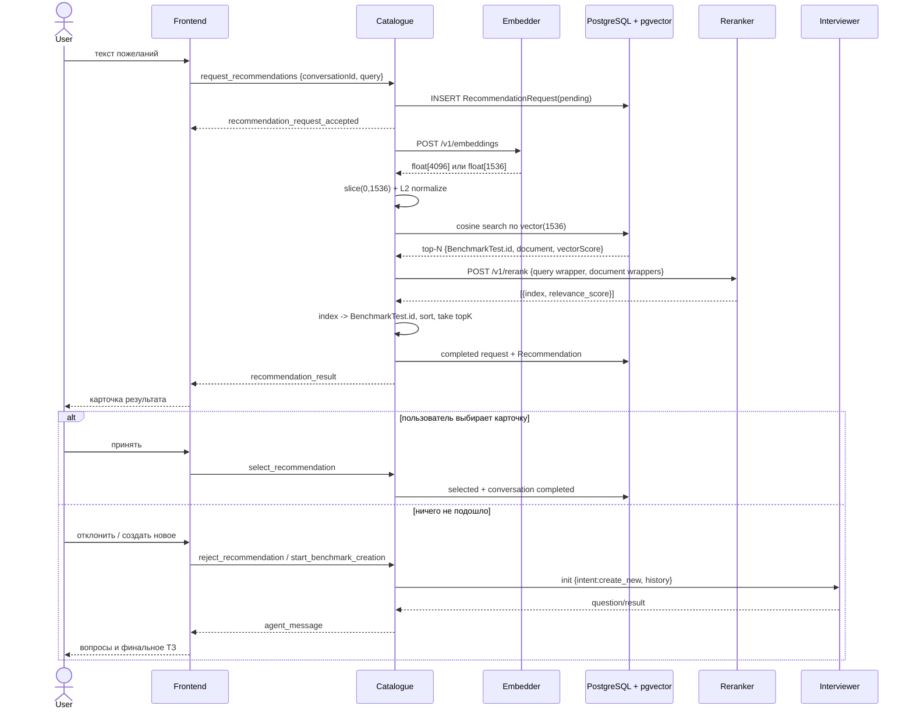

# Рекомендации BenchmarkTest: полный workflow

> **Дополнительные технические материалы.** Общую картину текущих двух сервисов и практические ограничения смотрите в [новом руководстве](recommendations-and-interviewer.md). Этот файл сохраняет детали отдельного модуля; при противоречии с текущими маршрутами/границами ответственности используйте новое руководство и код.

## Кто за что отвечает

- Catalogue backend собирает поисковый текст карточек, вызывает модели,
  выполняет pgvector-поиск, сопоставляет индексы reranker с ID и хранит итог.
- Embedder — отдельный stateless HTTP endpoint. Он ничего не знает о БД.
- PostgreSQL + pgvector хранит нормализованные векторы и выбирает top-N.
- Reranker — отдельный stateless HTTP endpoint. Он получает query и тексты.
- Interviewer не участвует в рекомендациях. Он запускается только по явному
  переходу пользователя к созданию нового бенчмарка.



Финальный `result` интервьюера не является рекомендацией каталога и поэтому
не рисуется как `RecommendationCard`. Он сохраняется как обычный результат
создания и одинаково восстанавливается после reload. `testId` допустим
только если за ним действительно существует созданный Test Catalogue;
фиктивные ID передавать не нужно.

## Поисковый документ

Единица рекомендации — опубликованный `BenchmarkTest`. Для него
`BenchmarkSearchDocumentBuilder` склеивает обычный текст:

- название BenchmarkTest и родительского Benchmark;
- описания, постановку задачи и инструкции;
- язык, сложность, task type, домены и остальные taxonomy;
- описание каждого DatasetSubset.

Документ не режется в Catalogue. После создания, изменения, публикации или
удаления карточки поисковая проекция синхронизируется. Массовая перестройка:

```bash
npm run search:reindex
```

## Embedder

Для пользовательского запроса Catalogue отправляет:

```json
{
  "model": "Qwen/Qwen3-Embedding-8B",
  "input": [
    "Instruct: Given a user request describing the desired AI benchmark, retrieve the most relevant benchmark or test description.\nQuery: Нужен медицинский бенчмарк"
  ]
}
```

Для индексируемых документов передаётся чистый текст без `Instruct/Query`.
Поле `dimensions` намеренно не отправляется. Ответ допускается только двух
размеров:

- 4096: берутся первые 1536 чисел;
- 1536: берётся весь вектор;
- любая другая длина: ошибка.

После этого Catalogue проверяет конечность чисел и ненулевую норму, затем
делит каждую координату на L2-норму. В БД попадает ровно 1536 float со
суммой квадратов около единицы. Batch индексации по умолчанию — 32, timeout —
120 секунд, после первой ошибки возможно ещё две попытки.

## pgvector

В таблице `benchmark_search_documents` хранятся текст, content hash, spec ID,
дата исходной карточки и `vector`. Поиск использует cosine distance:

```sql
1 - (embedding <=> query_vector) AS vector_score
```

Участвуют только опубликованные, не удалённые и синхронизированные документы с
тем же `embedding_spec_id` и размерностью. Сейчас это точный поиск без HNSW;
для текущего размера каталога он проще и предсказуемее.

## Reranker

Reranker получает не ID и не embeddings, а два вида строк. Query:

```text
<|im_start|>system
Judge whether the Document meets the requirements based on the Query and the Instruct provided. Note that the answer can only be "yes" or "no".<|im_end|>
<|im_start|>user
<Instruct>: Given a user request describing the desired AI benchmark, retrieve the most relevant benchmark or test description.
<Query>: Нужен медицинский бенчмарк
```

Каждый document:

```text
<Document>: <текст BenchmarkSearchDocument><|im_end|>
<|im_start|>assistant
<think>

</think>

```

Ответ `results[].index` — позиция в отправленном массиве. Catalogue валидирует
уникальность и диапазон index, score от 0 до 1, сам возвращает ID кандидата,
сортирует по score и только после этого применяет `topK`. Максимум — 100
документов за вызов.

Если ответ reranker некорректен или endpoint недоступен, при включённом fallback
сохраняется исходный порядок pgvector и `rerankScore = null`.

## ENV

Полный список и локальные значения находятся в `.env.example`. Для разных
контуров меняются provider, URL, ключи, model и spec ID. Ключи не хранятся в
исходниках. При смене embedding-модели или алгоритма подготовки документа нужен
новый `EMBEDDING_SPEC_ID` и полный reindex.
