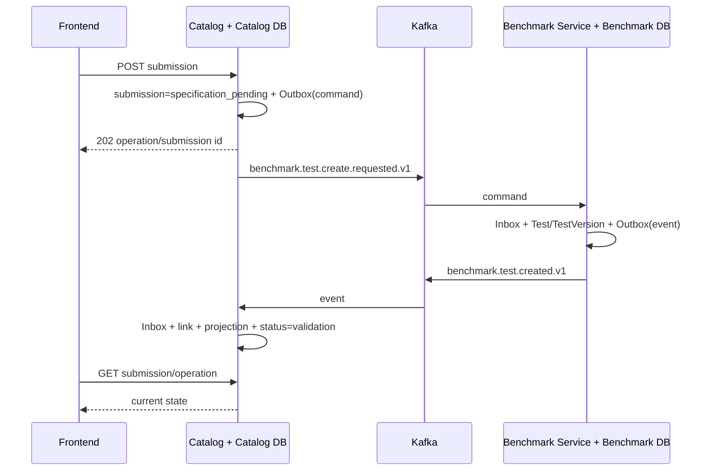

# Архитектура интеграции Benchmark Service

> **Исторический документ.** Содержимое ниже фиксирует прежний этап/план и может описывать монолит, переходные таблицы, будущий Run или уже неактуальные команды. Для работы после разделения используйте [актуальную архитектуру](architecture.md), [локальный запуск](local-development.md) и [тестирование](testing.md). Не воспринимайте этот файл как текущий контракт.

**Статус:** принято для реализации  
**Дата:** 2026-09-06

## Решение

Benchmark Service и Benchmark Catalog становятся независимо развёртываемыми
сервисами с отдельными PostgreSQL-базами. Рабочая интеграция Catalog с
Benchmark Service выполняется асинхронно через Kafka:

- исходящие команды и события записываются вместе с бизнес-изменением в
  локальный Outbox;
- publisher отправляет их в Kafka с постоянным `eventId`;
- consumer применяет изменение и записывает `eventId` в Inbox в одной локальной
  транзакции;
- временные ошибки повторяются с backoff, исчерпанные попытки попадают в DLQ;
- порядок сообщений одного агрегата обеспечивается одинаковым Kafka key;
- Catalog читает собственную проекцию Benchmark/Test и не делает синхронный
  межсервисный join на пользовательском запросе.

Kafka не заменяет публичный API Benchmark Service. Самостоятельный Benchmark
Service сохраняет versioned HTTP API для frontend, административных клиентов и
других проектов. Запрет относится к обязательной синхронной зависимости
Catalog → Benchmark Service в основном workflow.

## Владение данными

### Benchmark DB

- `Benchmark`;
- `Test` и `TestVersion`;
- `DatasetSubsample`;
- examples, references, links и статистика внешнего датасета;
- evaluation logic и GigaMetrics-конфигурация;
- taxonomy-привязки Test;
- назначения стабильных `metricId`;
- собственные Inbox и Outbox.

### Catalog DB

- `CatalogEntry`/`CatalogSubmission`;
- автор, moderation status, rejection reason и reviewer audit;
- ссылка `benchmarkId + testId + testVersion` без foreign key в Benchmark DB;
- versioned snapshot/read projection для карточек и списков;
- поисковый индекс и состояние его синхронизации;
- рекомендации, conversations и пользовательские workflow;
- уникальная связь submission с исходной Conversation; эта ссылка не входит в
  Benchmark DB и не передаётся как владение Benchmark Service;
- собственные Inbox и Outbox.

### Metrics/Evaluation DB — отдельная граница

- `Metric`;
- `Model`/`ModelVersion`;
- `Run`;
- `MetricResult`;
- собственные Inbox и Outbox.

На первом физическом шаге Metrics может оставаться в текущем deploy, но его
таблицы не переносятся в Benchmark DB. Benchmark хранит только стабильные
`metricId`; межсервисных FK нет.

Каждый сервис имеет собственные credentials, migrations, backup/restore,
retention и deploy lifecycle. Одна PostgreSQL-инстанция с разными базами может
использоваться временно инфраструктурно, но схема и доступ остаются раздельными.

## Потоки

### Создание Test из Catalog

Если команда бизнесово невалидна, Benchmark Service публикует
`benchmark.command.rejected.v1` с безопасным machine-readable reason. Catalog
переводит операцию в `specification_failed`; автоматический retry применяется
только к техническим ошибкам.

### Изменение спецификации

- Catalog записывает команду создания новой `TestVersion` в Outbox;
- Benchmark Service не меняет опубликованную/использованную версию на месте;
- событие новой версии обновляет Catalog projection;
- CatalogEntry проходит повторную модерацию новой версии;
- старый snapshot и результаты остаются привязаны к старой версии.

### Чтение

Публичные списки, detail, search и recommendations читаются из Catalog DB и
поисковой проекции. Недоступность Benchmark Service или Kafka не делает уже
синхронизированный Catalog нечитаемым. UI показывает состояние синхронизации
для ещё не завершённых команд.

## Контракт сообщений

Обязательные поля envelope:

- `eventId`/`messageId` — UUID, не меняется при повторной доставке;
- `eventType` и `eventVersion`;
- `occurredAt` в UTC;
- `correlationId` — один workflow;
- `causationId` — сообщение-причина;
- `producer`;
- `aggregateType`, `aggregateId`, `aggregateVersion`;
- `data` без Prisma-типов и внутренних полей БД.

Правила:

- Kafka key для Benchmark — `benchmarkId`, для Test — `testId`; команда создания
  до появления `testId` использует заранее сгенерированный `testId`;
- несовместимое изменение получает новую версию события;
- consumer принимает известные старые версии во время миграционного окна;
- секреты, токены и полный внешний dataset в события не попадают;
- событие содержит достаточно данных для обновления проекции либо consumer
  применяет отдельный явно версионированный snapshot event.

## Гарантии и ограничения

- Доставка at-least-once: дубликаты нормальны и отбрасываются Inbox.
- Outbox устраняет окно «БД записана, Kafka не отправлена».
- Inbox устраняет повторное применение уже обработанного сообщения.
- Одна транзакция существует только внутри одной БД; распределённых транзакций
  нет.
- Exactly-once бизнес-эффект достигается идемпотентностью, а не обещанием Kafka.
- События разных aggregate могут приходить в любом порядке.
- Consumer не применяет устаревшую `aggregateVersion`; пропуск версии вызывает
  retry/reconciliation, а не тихое затирание свежей проекции.

## Набор обязательных тестов

1. Контрактные schema-тесты всех версий команд и событий.
2. Атомарность business row + Outbox на реальном PostgreSQL.
3. Повтор одного `eventId` не создаёт второй Test/CatalogEntry/результат.
4. Повтор одной Kafka position с другим `eventId` не применяется.
5. Retry/backoff, restart recovery и DLQ после лимита попыток.
6. Бизнесовая ошибка не ретраится бесконечно.
7. Out-of-order и stale `aggregateVersion` не откатывают projection.
8. Happy path, rejection, timeout и duplicate для submission saga.
9. Catalog продолжает читать последнюю проекцию при недоступных Kafka и
   Benchmark Service.
10. Полное восстановление projection из event log/snapshot topic.
11. Один reusable Benchmark contract suite проходит против монолита и
    выделенного сервиса.
12. Сверка row counts, идентификаторов и checksums до переключения БД.

## Порядок миграции без big bang

1. Ввести transport-neutral contracts и заранее генерируемые идентификаторы.
2. Добавить в текущую БД Catalog projection и состояние асинхронной операции.
3. Перевести локальные записи на Outbox/Inbox, оставив consumer внутри монолита.
4. Поднять Benchmark DB и выполнить snapshot copy + CDC/event catch-up.
5. Запустить shadow consumer и сравнить проекции/контракты.
6. Переключить команды на отдельный Benchmark Service; чтения Catalog уже идут
   из локальной проекции.
7. Выдержать rollback window, прекратить двойную запись.
8. Удалить Benchmark/Test таблицы и Prisma-связи из Catalog только после
   reconciliation и успешных contract/e2e/chaos тестов.

## Запрещённые зависимости в целевой системе

- общий `DATABASE_URL` или credentials с правом записи в обе базы;
- cross-database FK;
- импорт Prisma-моделей одного сервиса другим;
- общая транзакция Catalog + Benchmark;
- runtime SQL join между сервисами;
- обязательный синхронный вызов Benchmark Service для выдачи Catalog;
- редактирование Catalog projection как канонической спецификации Test.
