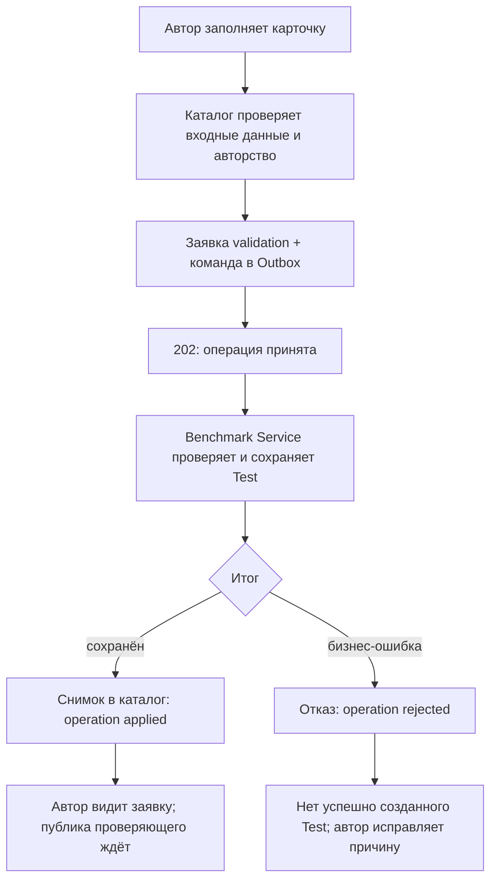
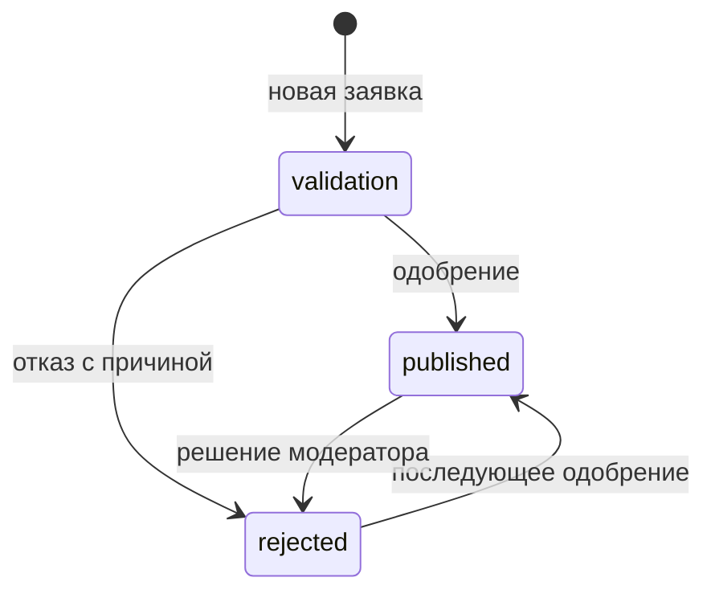

# Пользовательские процессы

Эта глава описывает существующие действия, без ML-терминов там, где они не нужны. Точные запросы — в [API](api-guide.md), определения — в [доменном контракте](benchmark-domain-contract.md).

## 1. Просмотр каталога

Пользователь открывает каталог, выбирает фильтры и карточку конкретного Test.

Каталог соединяет свою копию Test с группой Benchmark, названиями справочников и решением о публикации. Для публичной карточки нужны одновременно:

1. Полное активное описание Test в локальной копии.
2. Активная родительская группа Benchmark.
3. CatalogEntry со статусом `published`, без архивации.

`validation` и `rejected` скрыты из публичных карточек, поиска, рекомендаций и публичного чтения результатов. По известному ID такой Test возвращает 404, а не раскрывает скрытую заявку.

Автор видит собственные заявки, в том числе неопубликованные, через `/catalog/submissions/mine` и `/catalog/submissions/{testId}`. Администратор использует `/benchmark-tests/management`.

**Исключение:** список групп `/benchmarks` и `/benchmarks/options` — список активных Benchmark, а не только групп с опубликованными карточками. Их `benchmarkTestsCount` — не счётчик публичных карточек: он учитывает активные полные копии Test независимо от модерации.

## 2. Предложить новый Test

Автор заполняет карточку: выбирает Benchmark, пишет название и описание, классификацию, метрики, инструкции и ссылки.

Статус и автора нельзя выбрать в теле карточки. Автор берётся из учётной записи. Новая пользовательская заявка всегда начинается с `validation`.

При связи с диалогом создания каталог проверяет, что диалог принадлежит автору, завершён и относится к созданию нового Test. Одна беседа не может породить несколько независимых заявок повторными отправками.

Администратор может создать Test напрямую через `POST /benchmark-tests`. Создание само по себе также не является публикацией.

Дубликаты названий проверяет владелец данных: уникальность Benchmark и уникальность Test внутри группы. Поэтому после `202` ещё может прийти отказ 409. Если создание отказано, каталог убирает неуспешную заготовку заявки, а не оставляет её как рабочий Test.

## 3. Модерация

Модератор просматривает заявку и принимает одно из двух решений:

| Решение | Что сохраняется | Что видит пользователь |
| --- | --- | --- |
| `published` | Статус, проверяющий, время; причина отказа очищается | Карточка доступна публике, поиску и рекомендациям |
| `rejected` | Статус, проверяющий, время и причина | Публика не видит карточку; автор видит отказ |

Для отклонения нужна непустая причина, до 2000 символов. Для публикации — как минимум одна назначенная существующая Metric. Каталог также не допускает публикацию во время незавершённого изменения Test.

Модерация — изменение собственной БД каталога, поэтому это обычный ответ HTTP 200, не команда изменения описания в источнике.

После публикации каталог обновляет поисковый документ. Если вызов индексации не удался, решение о публикации может уже сохраниться. Это диагностируется readiness и исправляется `search:reindex`; не следует объявлять все действия успешными только по статусу публикации.

Диаграмма показывает каталоговые статусы. Удаление Test — отдельное состояние в источнике, оно не является четвёртым значением этого enum.

## 4. Изменить описание

Администратор отправляет частичный PATCH в каталог. Неуказанные поля сохраняются: например, изменение description не удаляет ссылки, метрики и DatasetSubsample.

Для массивов:

- Не передали поле — оставить прежний массив.
- Передали массив — заменить его на новый.
- Передали `[]` — очистить, если это допускают последующие правила.

Каталог проверяет **получившуюся карточку**, а не только присланный фрагмент. Например, нельзя поменять macroGroup и оставить subGroup от другой группы. Subdomain должен принадлежать одному из выбранных domains.

Каталог преобразует итог в полное описание для источника и отправляет команду с ожидаемой редакцией. Источник отклоняет устаревшую запись; пользователь перечитывает данные и повторяет осмысленное изменение.

Пока нет полноценного версионирования, Test с уже сохранёнными результатами **не редактируется и не удаляется**. Это намеренная защита смысла исторических чисел, а не незавершённая форма.

## 5. Удалить и восстановить

Удаление Benchmark/Test мягкое: строка остаётся с `deletedAt`, а обычное чтение её скрывает.

- Test с результатами удалять нельзя.
- Benchmark с активными Test удалять нельзя: сначала решают вопрос с его Test.
- Нельзя восстановить Test под удалённым Benchmark: сначала восстановить группу.
- Каталоговая команда возвращает 202; исчезновение/появление проверяется после `applied`.
- Название удалённого объекта может потребовать восстановления прежнего объекта вместо создания копии; конфликт может содержать `deletedId`.

Восстановление собственной заявки автором возвращает её на проверку `validation` и очищает прежнее решение **после подтверждения источника**. Если восстановление отказано, каталог не должен заранее сбросить модерацию.

Административное восстановление Test не означает автоматическую смену его решения о публикации. Публичная видимость по-прежнему зависит от CatalogEntry.

В обычной форме пользователь не получает права физически очищать БД. DELETE Benchmark/Test разрешён SuperUser; восстановление и редактирование — Admin/SuperUser; собственную заявку автор восстанавливает отдельным маршрутом.

## 6. Загрузить результат

Вычисление выполняется вне этих сервисов. Каталог получает готовое значение.

Пример: внешняя система проверила модель на Test и получила долю точных ответов. Она отправляет `testId + metricId + modelId + value`.

Каталог проверяет:

1. Test имеет активную полную копию и активную родительскую группу. Запись результата не требует published; публичное чтение требует.
2. Metric существует и **уже назначена этому Test**.
3. Model существует и не является специальной подменой `human`.
4. Значение — конечное число, пригодное для хранения. Попадание в minValue/maxValue текущий API результатов не проверяет.
5. Нет конфликта с незавершённым изменением описания Test.

Сохранение результата не назначает новую Metric автоматически. После первого результата каталог записывает команду блокировки описания Test в свой Outbox. Источник сохраняет блокировку и сообщает о ней снимком. До её доставки каталог уже защищает свой путь записи локальными проверками.

Поле scores карточки показывает последние значения по парам Model–Metric; отдельный API результатов возвращает страницу истории. Разные Metric не складываются в единую оценку. Повторная запись результата — ещё одна запись результатов, **не Run**.

Создание результата изменяет состояние Test для последующего редактирования. Поэтому проверять эту операцию вручную лучше на отдельной тестовой карточке, а не на исходных 40 Test, которые хочется свободно редактировать.

## 7. Найти подходящий Test по описанию

Пользователь пишет обычным языком, что ему требуется проверить.

Каталог превращает текст в числовое представление, ищет подходящие опубликованные карточки и уточняет их порядок. Полученные рекомендации сохраняются с диалогом.

Ноль подходящих карточек — допустимый успешный результат. Ошибка модельного сервиса — не «пустой каталог», а отдельный неуспешный запрос.

Пользователь выбирает рекомендацию или отказывается. Повтор той же кнопки обрабатывается безопасно; противоположное решение после уже сохранённого выбора вызывает конфликт. Чужую рекомендацию выбрать нельзя.

Число пригодности рекомендации относится к **поиску**, а не к качеству оцениваемой модели. Подробно: [рекомендации и интервьюер](recommendations-and-interviewer.md).

## 8. Уточнить требования к новому Test

Если готового Test нет или пользователь хочет создать новый, открывается диалог с интервьюером.

Интервьюер задаёт вопросы и помогает сформулировать задачу. Каталог хранит беседу и передаёт сообщения. Соединение браузера с каталогом — Socket.IO, соединение каталога с внешним интервьюером — WebSocket.

Завершение разговора и гипотезы не равны публикации Test. Оформление/отправка заявки и модерация остаются отдельными шагами. Гипотеза — предложенная формулировка, не запущенное испытание и не результат Metric.

## 9. Что проверять при приёмке

Минимальный осмысленный путь:

1. Открыть исходные карточки, фильтры, ссылки и примеры.
2. Создать отдельную группу и Test с уникальным суффиксом; дождаться `applied`.
3. Проверить: автор видит `validation`, публичное чтение даёт 404.
4. Назначить Metric и опубликовать: карточка появляется в каталоге и поиске.
5. Изменить только описание: прочие поля и UUID DatasetSubsample сохраняются.
6. Проверить отклонение дубликата и неверного справочника/иерархии.
7. На отдельном Test принять результат только назначенной Metric; после него изменение/удаление запрещено.
8. На Test **без результатов** проверить удаление и восстановление, включая удалённого родителя.
9. Проверить рекомендации, выбор/повтор выбора и отсутствие доступа к чужому диалогу.
10. После проверок убрать собственные временные объекты допустимыми API-действиями.

Автотесты и живая проверка дополняют друг друга; зелёные unit-тесты не доказывают доступность реальной Kafka или внешнего интервьюера.
