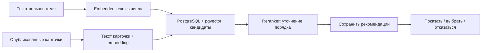

# Рекомендации и интервьюер

Это два разных помощника. Ни один из них не запускает Benchmark/Test и не создаёт MetricResult.

## 1. Рекомендации: найти уже существующую карточку

Пример запроса пользователя: «Мне нужно проверить русскоязычную модель на сложных вопросах по естественным наукам».

Каталог ищет Test с подходящим описанием:



### Слова, которые встретятся в коде

- **Embedding** — список чисел, представляющий содержание текста. Это не результат испытания модели.
- **Embedder** — сервис, который выдаёт такой список.
- **pgvector** — возможность PostgreSQL сравнивать такие списки и искать близкие.
- **Retrieval** — первичный поиск нескольких кандидатов.
- **Reranker** — дополнительная сортировка: получает запрос и тексты кандидатов.
- **TopK** — сколько вариантов оставить.
- **Score** рекомендации — пригодность карточки для запроса, не качество модели на Test.

Сначала каталог строит поисковый документ из опубликованной карточки. Документ содержит текст, hash содержимого, числовое представление и идентификатор конфигурации embedding. Устаревший документ нельзя бездумно сравнивать с новым запросом по другой конфигурации.

### Текущий путь

Запрос сохраняется в `recommendation_requests` как pending, затем выполняется **в процессе каталога**, с HTTP-вызовами embedder/reranker. По завершении сохраняется completed с результатами либо failed с причиной. Kafka в этом pipeline сейчас не является очередью рекомендаций.

Каталог сохраняет сведения о кандидатах и версиях конфигурации поиска/сортировки для диагностики. Это не ModelVersion оцениваемой модели и не Run.

Публикация и актуальность карточек проверяются при поиске и использовании кандидатов. Рекомендации сохраняются как записи, привязанные к диалогу и testId.

Успешный пустой список и failed — разные исходы. При разрешённом fallback отказ reranker может привести к использованию исходного векторного порядка; отказ embedding так обойти нельзя.

## 2. Где здесь WebSocket

```text
Браузер ── Socket.IO ──► Catalog
                          ├── HTTP ──► Embedder / Reranker
                          │
                          └── WebSocket ──► Интервьюер
```

Socket.IO позволяет браузеру получать результат и сообщения без отдельных HTTP-запросов на каждую реплику. Внешний интервьюер использует собственный WebSocket-протокол.

Kafka между Catalog и Benchmark Service решает доставку доменных изменений. Она не заменяет интерактивный диалог с интервьюером и не транспортирует нынешний HTTP-вызов reranker.

## 3. Интервьюер: помочь описать новый Test

Интервьюер уточняет задачу, когда нужно создать новый Test. Каталог отвечает за вход пользователя, владение диалогом, сохранение сообщений и передачу реплик.

Открытие страницы каталога или просмотр старой завершённой беседы само по себе не должно порождать внешнюю сессию. Сессия нужна активному сценарию создания. Одно соединение с интервьюером привязано к конкретной беседе.

Существующие состояния Conversation:

| status | Смысл |
| --- | --- |
| active | Диалог идёт |
| awaiting_choice | Ожидается решение по предложенным вариантам |
| completed | Сценарий завершён |
| abandoned | Диалог оставлен |

Intent `find_existing` — поиск готового, `create_new` — уточнение нового. Сообщения и генерации гипотез сохраняются в БД, а открытые сокеты и привязки браузеров — в памяти процесса.

Гипотезы — предложенные формулировки; у попытки генерации есть собственный pending/completed/failed. Они не становятся опубликованным Test без отдельного оформления заявки и модерации.

## 4. События браузерного Socket.IO

Подключение: default namespace, path `/api/socket.io`, пользовательская cookie и допустимый Origin.

| Событие от клиента | Основной payload | Ответ / смысл |
| --- | --- | --- |
| start_chat | conversationId, если продолжаем существующий | chat_started с conversationId |
| send_message | conversationId, kind, value, необязательный label | Сохранение и передача сообщения |
| request_recommendations | conversationId, query | recommendation_request_accepted, затем recommendation_result |
| select_recommendation | recommendationId | recommendation_updated, выбранный Test |
| reject_recommendation | recommendationId | recommendation_updated и переход к созданию |
| start_benchmark_creation | conversationId | benchmark_creation_started |
| regenerate_hypotheses | conversationId | Новая попытка генерации |

Асинхронные уведомления: `agent_message`, `hypotheses_generated`, `error`. Для структуры конкретного ответа смотрите gateway и типы; отправлять произвольный JSON напрямую во внешний WebSocket вместо Socket.IO нельзя.

В браузерной команде recommendations текущий сервер сам выбирает topK=1. Внутренний сервис поддерживает значения 1–20, но это не объявляет параметр topK частью браузерного контракта.

Выбор и отказ имеют защиту от повторов и проверки владельца. Нельзя принять чужую рекомендацию по известному ID. Сообщения одной беседы обрабатываются последовательно, чтобы не перепутать порядок реплик.

## 5. Что ограничивает нагрузку

Здесь нет обещания «любое число сокетов выдержим». Есть конкретные защитные ограничения.

| Настройка | По умолчанию | Что ограничивает |
| --- | --- | --- |
| RECOMMENDATION_MAX_CONCURRENT_EXECUTIONS | 16 | Одновременные исполнения подбора в одном процессе |
| AGENT_MAX_ACTIVE_SESSIONS | 200 | Внешние сессии интервьюера в одном процессе |
| AGENT_MAX_PENDING_MESSAGES_PER_SESSION | 32 | Неотправленные сообщения одной сессии |
| AGENT_MAX_BUFFERED_BYTES_PER_SESSION | 1 MiB | Размер очереди/буфера сессии |
| AGENT_MAX_PAYLOAD_BYTES | 1 MiB | Одно сообщение |
| AGENT_SESSION_IDLE_TIMEOUT_MS | 1 800 000 | Очистка простаивающей сессии: 30 минут |
| AGENT_RECONNECT_MAX_ATTEMPTS | 8 | Лимит переподключения к интервьюеру |
| AGENT_RECONNECT_INITIAL_DELAY_MS / MAX_DELAY_MS | 500 / 15 000 | Задержка переподключения |
| AGENT_HEARTBEAT_INTERVAL_MS / TIMEOUT_MS | 25 000 / 10 000 | Проверка живого внешнего соединения |

Если слотов подбора больше нет, запрос получает сохранённую ошибку `RECOMMENDATION_OVERLOADED` с retryable=true. Он не складывается в бесконечную очередь. retryable означает «можно повторить», не автоматическое выполнение позже.

Если исчерпаны внешние сессии интервьюера, новое открытие отклоняется. Если переполнена очередь или буфер одной сессии, она завершается ошибкой; данные не копятся неограниченно. Слишком большой payload также отвергается.

При обрыве применяются переподключение и heartbeat. При закрытии привязанного браузерного соединения внешняя сессия закрывается. Очередь исходящих сообщений — память, не надёжное хранилище на диск.

Все эти лимиты относятся к **одному процессу**, не всему кластеру. Привязки сокетов, очереди и сериализация бесед сейчас также локальны процессу. Нельзя считать, что несколько реплик уже имеют общий Socket.IO adapter/общую блокировку бесед. Масштабирование требует отдельной проверки маршрутизации соединений.

## 6. Настройки модельного поиска

| Настройка | Смысл |
| --- | --- |
| EMBEDDING_PROVIDER=mock | Детерминированный локальный заменитель для проверки обвязки |
| EMBEDDING_PROVIDER=openai-compatible | HTTP-сервис с совместимым форматом; не обязательно сервис OpenAI |
| EMBEDDING_URL / MODEL / API_KEY | Адрес, модель и секрет внешнего embedder |
| EMBEDDING_DIMENSIONS | Размер хранения вектора: строго 1536 |
| EMBEDDING_SOURCE_DIMENSIONS | Размер исходного представления: строго 4096 |
| EMBEDDING_TIMEOUT_MS | По умолчанию 120 000 |
| RETRIEVAL_CANDIDATE_LIMIT | По умолчанию 20, не больше лимита reranker и 100 |
| RERANKER_PROVIDER=mock / qwen-compatible | Локальная или HTTP-сортировка |
| RERANKER_URL / MODEL / API_KEY | Параметры внешней сортировки |
| RERANKER_TIMEOUT_MS | По умолчанию 120 000 |
| RERANKER_FALLBACK_TO_VECTOR | Разрешение использовать векторный порядок при отказе reranker |

Mock проверяет корректность маршрутов и сохранения данных, **не качество настоящей ML-рекомендации**. После смены модели/конфигурации индекс надо сверить и при необходимости перестроить.

Интервьюер: `AGENT_MODE=mock` для локальной проверки или `ws` с THIRD_PARTY_WS_URL и при необходимости THIRD_PARTY_API_KEY. Mock-режимы запрещены в production-проверке окружения. Реальные секреты не кладите в примеры, git и логи.

## 7. Как проверять

1. На mock убедиться, что запрос получает ID, завершается и сохраняется.
2. Проверить пустой поиск, повтор выбора, конфликт решения и чужие ID.
3. Проверить неуспешный embedder, fallback reranker и превышение параллелизма.
4. В реальном ws-режиме проверить обрыв, переподключение, idle timeout и закрытие браузера.
5. Отдельно нагрузочно измерить задержки, память, число сессий и ресурсы внешних модельных сервисов.

Unit/e2e проверяют отказоустойчивые ветки, но не устанавливают фактическую пропускную способность Dev/Prod. Локальный mock не является нагрузочным доказательством для реального интервьюера.
